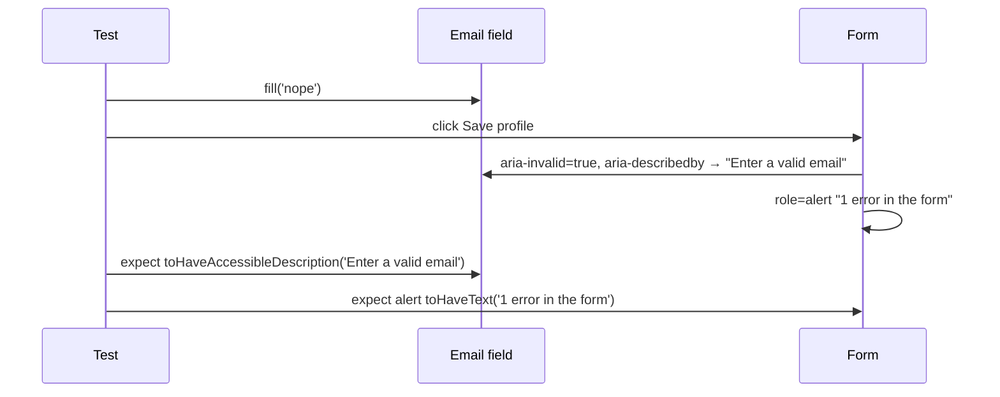

# Card 45: Native Form Controls

The portable agent skills for this pattern are `playwright-interactions`, `playwright-locators` and `playwright-assertions`.

## What This Pattern Solves

Text inputs, checkboxes, radios, selects and buttons each carry state the browser already tracks: value, checked, selected, disabled, accessible description. You get flaky or wrong tests when you drive these controls with generic `click()` calls and read state back with `getAttribute` or `innerText`. Playwright has one action and one matcher for each control. Use them and the test reads like the form.

## How It Works

1. **Text**: `fill()` replaces the value in one input event. `clear()` empties it. `pressSequentially()` types key by key for widgets that listen to keys.
2. **Checkboxes and radios**: `check()`, `uncheck()` and `setChecked(bool)` are idempotent and verify the result. Assert with `toBeChecked()`.
3. **Selects**: `selectOption()` takes a value, a `{ label }`, or an array for `multiple`. Assert with `toHaveValue()` or `toHaveValues()`.
4. **Pointer**: `hover()` for CSS `:hover` content, `dblclick()`, and `click({ button: 'right' })` for context menus.
5. **State**: `toBeDisabled()` / `toBeEnabled()` instead of trying to click.
6. **Validation**: `toHaveAccessibleDescription()` proves the error belongs to the field, and `getByRole('alert')` covers the form-level summary.

## Code Example

```typescript
await page.getByLabel('Accept terms').check();
await expect(page.getByLabel('Accept terms')).toBeChecked();

await page.getByLabel('Country').selectOption({ label: 'Canada' });
await expect(page.getByLabel('Country')).toHaveValue('ca');

await page.getByLabel('Toppings').selectOption(['cheese', 'olives']);
await expect(page.getByLabel('Toppings')).toHaveValues(['cheese', 'olives']);

// Bad: the text exists somewhere on the page, maybe next to the wrong field.
await expect(page.getByText('Enter a valid email')).toBeVisible();
// Good: a screen reader hears this error on this field.
await expect(page.getByLabel('Email')).toHaveAccessibleDescription('Enter a valid email');
```

## Run This Example

```bash
pnpm test src/45-native-form-controls
```

## Prerequisites

- **Card 11**: Form interactions (fill, click, submit).
- **Card 12**: Locators, actions and flows.

## Key Concepts

- **`fill()` vs `pressSequentially()`**: `fill` sets the value and fires one `input` event. Key handlers see nothing. Reach for `pressSequentially` only when the widget reacts to individual keys.
- **`clear()`**: Sends a Delete key after selecting the text, so key counters see one extra keydown.
- **`check()` vs `click()`**: `click` toggles. `check` leaves a checked box checked and throws if the box ends up unchecked.
- **`setChecked(value)`**: Drive the target state from test data.
- **`selectOption(string)`**: Matches by value or label. Pass `{ value }` or `{ label }` to be explicit.
- **`toHaveValues([...])`**: The matcher for `<select multiple>`.
- **`toHaveAccessibleDescription()`**: Reads `aria-describedby`, the link between a field and its error text.
- **Radio scoping**: Wrap radios in a `<fieldset>` with a `<legend>` and scope with `getByRole('group', { name })`.

## When to Use This Pattern

- ✓ Any form built on native `<input>`, `<select>` and `<button>`.
- ✓ Asserting validation messages land on the right field.
- ✓ Hover menus and tooltips driven by CSS `:hover`.
- ✗ Custom comboboxes and listboxes (Card 40, shadcn components).
- ✗ Keyboard shortcuts and drag and drop (Card 48).

## Common Mistakes

1. **`click()` on a checkbox**: Toggles. If the default changes to checked, your test unchecks it and still "passes" the action.
2. **Clicking a disabled button to prove it is disabled**: The click waits for the button to enable and times out. Assert `toBeDisabled()`.
3. **Asserting error text with `getByText`**: Proves the text exists. Use `toHaveAccessibleDescription` on the field.
4. **`pressSequentially` everywhere**: Slower and noisier than `fill`. Use it for key-driven widgets only.
5. **Reading `inputValue()` into a variable and comparing**: A one-shot read. `toHaveValue` retries until it holds.

## Flow Diagram



## Related Patterns

- **Previous**: Card 44 (Agentic MCP → CI).
- **Next**: Card 46 (Browser Dialogs).
- **Complementary**: Card 17 (Accessibility with axe), Card 39 (Accessible Components), Card 40 (shadcn Components).
