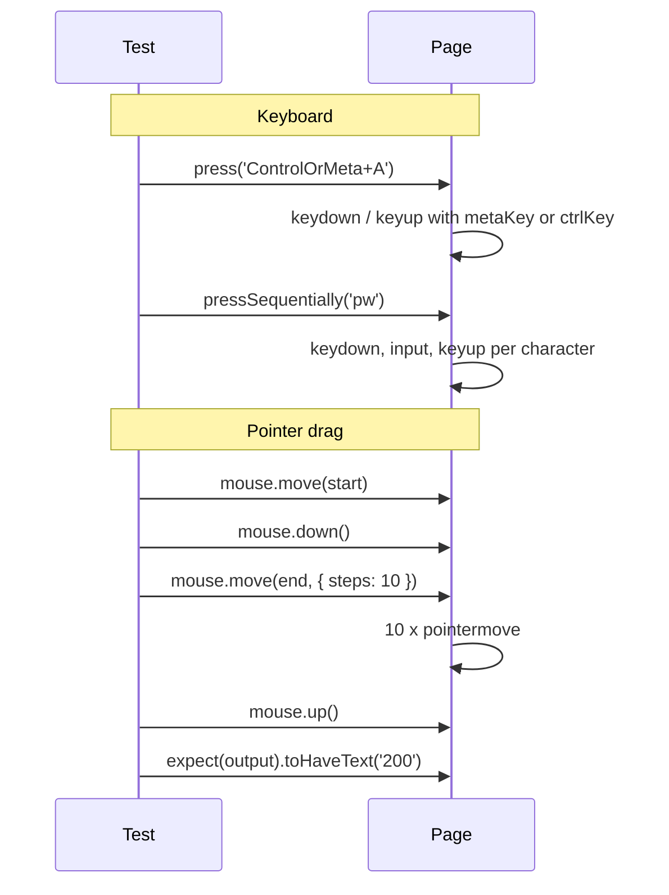

# Card 48: Keyboard, Mouse & Drag

The portable agent skill for this pattern is `playwright-interactions`.

## What This Pattern Solves

`click()` and `fill()` cover most of a test suite. They miss the widgets that listen to individual keys, focus moves, hover, and pointer movement: editors with shortcuts, comboboxes that react to `keydown`, tooltips on `mouseenter`, kanban boards, sliders. A test that uses `fill()` on a key-driven widget passes on a form and fails on the real component, or the reverse.

## How It Works

1. **`locator.press(key)`** sends one key or chord to a focused element. `ControlOrMeta+A` resolves to Cmd on macOS and Ctrl on Linux and Windows, so one test runs on every runner.
2. **`fill()` vs `pressSequentially()`**. `fill()` sets the value with one `input` event and fires no key events. `pressSequentially()` types each character with `keydown`, `keypress`, `input`, and `keyup`.
3. **Focus order** uses `page.keyboard.press('Tab')` and `expect(locator).toBeFocused()`. Assert where focus lands after each Tab.
4. **`hover()`** moves the pointer over the element and fires `mouseenter` and `mouseover`. Move the mouse away to prove the content hides again.
5. **`dragTo(target)`** drives HTML5 drag and drop (`dragstart`, `dragover`, `drop`).
6. **`page.mouse.move/down/up`** drives pointer-event libraries that `dragTo` does not satisfy. Pass `{ steps }` so the library sees movement past its drag threshold.

## Code Example

```typescript
const editor = page.getByLabel('Editor');
const search = page.getByRole('combobox', { name: 'Search' });
const knob = page.getByRole('slider', { name: 'Volume' });

// Shortcut that works on macOS and Linux
await editor.press('ControlOrMeta+A');
await editor.press('Backspace');

// Bad for key-driven widgets: no keydown fires
await search.fill('pw');
// Good: one key event per character
await search.pressSequentially('pw');

// Tab order
await page.getByLabel('Email').focus();
await page.keyboard.press('Tab');
await expect(page.getByLabel('Password')).toBeFocused();

// HTML5 drag and drop
await page.getByText('Write tests').dragTo(page.getByRole('list', { name: 'Done' }));

// Pointer-event drag library
const box = await knob.boundingBox();
expect(box).not.toBeNull();
await page.mouse.move(box!.x + box!.width / 2, box!.y + box!.height / 2);
await page.mouse.down();
await page.mouse.move(220, box!.y + box!.height / 2, { steps: 10 });
await page.mouse.up();
```

## Run This Example

```bash
pnpm test src/48-keyboard-mouse-drag
```

## Prerequisites

- **Card 01**: Basic page navigation and assertions.
- **Card 12**: Locators, actions, and flows.

## Key Concepts

- **`locator.press(key)`**: Focuses the element and sends a key or chord such as `Shift+Tab`, `Enter`, or `ControlOrMeta+K`.
- **`page.keyboard`**: Sends keys to whatever has focus. Use it after a Tab moves focus somewhere you do not hold a locator for.
- **`locator.pressSequentially(text, { delay })`**: Types one character at a time. Add `delay` for widgets that debounce per key.
- **`toBeFocused()`**: Web-first assertion on `document.activeElement`. It retries, so focus moved by a `setTimeout` still passes.
- **`locator.hover()`**: Scrolls the element into view and moves the pointer to its centre.
- **`locator.dragTo(target)`**: HTML5 drag and drop between two locators.
- **`page.mouse`**: Raw pointer control in CSS pixels from the viewport's top left. Read positions with `boundingBox()`.

## When to Use This Pattern

- ✓ Keyboard shortcuts and chorded commands.
- ✓ Comboboxes, editors, and inputs that react to `keydown`.
- ✓ Accessibility checks on focus order and focus traps.
- ✓ Tooltips and menus that open on hover.
- ✓ Kanban boards, sortable lists, sliders, and canvas drags.
- ✗ Plain form fields. `fill()` is faster and less flaky.
- ✗ File drops from the OS. Use `setInputFiles()` (Card 36).

## Common Mistakes

1. **Hard-coding `Control+A`**: The shortcut fails on a macOS laptop and passes in Linux CI. Use `ControlOrMeta`.
2. **Using `fill()` on a widget that listens to keys**: The value changes but suggestions never open. Switch to `pressSequentially()`.
3. **Calling `clear()` or `fill('')` and then counting keys**: Both clear the field with a Delete keypress, which your handler counts.
4. **Jumping the mouse in one move**: `mouse.move(x, y)` without `steps` sends one `pointermove`. Libraries with a drag threshold ignore it.
5. **Asserting focus with `evaluate(() => document.activeElement)`**: That reads once. `toBeFocused()` retries.
6. **Leaving the pointer on a hover target**: The next test step sees the tooltip still open. Move the mouse away when the test cares about the closed state.

## Flow Diagram



## Related Patterns

- **Previous**: Card 47 (Frames & Shadow DOM).
- **Next**: Card 49 (Tables & Grids).
- **Complementary**: Card 39 (Accessible Components), for keyboard support built into the markup.
