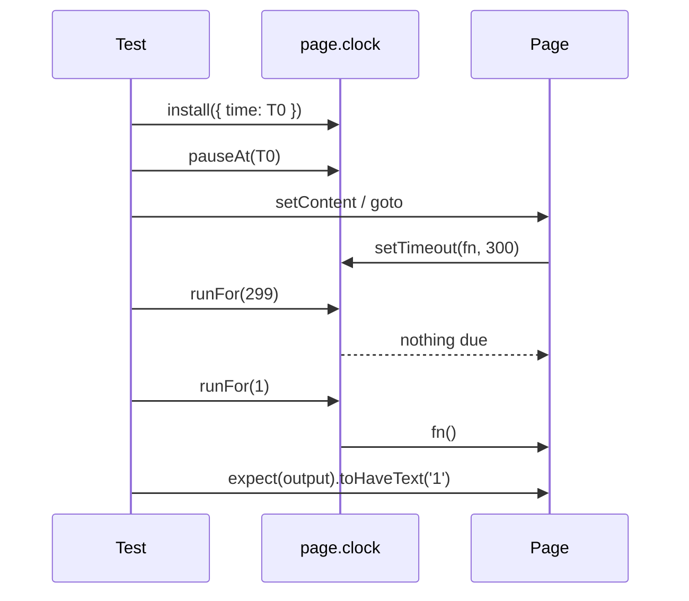

# Card 50: Clock Control

The portable agent skill for this pattern is `playwright-interactions`.

## What This Pattern Solves

Session timeouts, countdowns, debounced search, "posted 3 minutes ago", and holiday banners all depend on time. Tests that wait for real time are slow, and tests that guess with `waitForTimeout` flake on a busy runner. Tests that read `new Date()` pass in December and fail in January. `page.clock` gives the test control of time inside the page.

## How It Works

1. **`page.clock.install()`** replaces `Date`, `setTimeout`, `setInterval`, `requestAnimationFrame`, and `performance.now` in the page. Call it before `goto` or `setContent` so the page's scripts see the fake clock.
2. **Time still flows after `install()`** at real speed. Call `pauseAt(time)` when the test counts ticks, so nothing fires between your steps.
3. **`fastForward(ms)`** jumps ahead and fires due timers once. Use it for long timeouts.
4. **`runFor(ms)`** advances step by step and fires every timer in the window. Use it for intervals and debounce.
5. **`setFixedTime(date)`** pins `Date.now()` and leaves timers running. Use it for date-dependent rendering.

## Code Example

```typescript
// Session timeout: install before the page loads
await page.clock.install();
await page.goto('/account');

// Bad: 15 real minutes, or a shorter guess that flakes
// await page.waitForTimeout(15 * 60_000);

// Good: move the fake clock
await page.clock.fastForward('15:00');
await expect(page.getByRole('status')).toHaveText('Session expired');

// Debounce, in its own test: pause first so real time cannot fire the timer
const T0 = new Date('2026-01-01T00:00:00Z');
await page.clock.install({ time: T0 });
await page.clock.pauseAt(T0);
const search = page.getByLabel('Search');
const searches = page.locator('output');
await search.pressSequentially('pl');
await page.clock.runFor(200);          // pause shorter than the 300ms delay
await search.pressSequentially('ay');  // must restart the timer
await page.clock.runFor(299);
await expect(searches).toHaveText('0');
await page.clock.runFor(1);            // 300ms after the last keystroke
await expect(searches).toHaveText('1');

// Date-dependent UI
await page.clock.setFixedTime(new Date('2026-12-25T09:00:00Z'));
```

## Run This Example

```bash
pnpm test src/50-clock-control
```

## Prerequisites

- **Card 15**: Done signals.
- **Card 18**: Stability techniques.

## Key Concepts

- **`clock.install({ time })`**: Installs fake timers, starting at `time` if given. Time keeps flowing at real speed until you pause it.
- **`clock.pauseAt(time)`**: Jumps to `time` and stops the clock. Only `runFor` and `fastForward` move it after that.
- **`clock.resume()`**: Lets time flow again after a pause.
- **`clock.fastForward(ms | 'mm:ss')`**: Jumps ahead. Each due timer fires at most once, which mirrors a laptop waking from sleep.
- **`clock.runFor(ms | 'mm:ss')`**: Advances in order and fires every timer due in the window, including each `setInterval` tick.
- **`clock.setFixedTime(date)`**: `Date.now()` always returns `date`. Timers still run.
- **`clock.setSystemTime(date)`**: Changes the wall clock without firing timers, for testing a timezone or DST jump.

## When to Use This Pattern

- ✓ Session timeouts, inactivity logouts, token refresh.
- ✓ Countdowns, OTP resend timers, auto-dismissing toasts.
- ✓ Debounce and throttle.
- ✓ Relative dates and date-dependent banners.
- ✗ Server-side time. The fake clock lives in the browser; mock the API response (Card 02) for server dates.
- ✗ CSS animations and transitions. Use `reducedMotion: 'reduce'` or wait on the end state.

## Common Mistakes

1. **Installing after navigation**: Scripts that already read `Date` or scheduled timers keep the real clock. Install first.
2. **Counting ticks without pausing**: `install()` alone lets real time pass, so a 300ms debounce can fire between `pressSequentially` and `runFor(299)` on a slow runner.
3. **Typing every character at one instant**: With the clock paused, `pressSequentially('play')` lands all four keys at the same moment. A debounce that never resets its timer passes that test too. Advance time between chunks of typing so the reset matters.
4. **`fastForward` for an interval**: It fires each timer once. Use `runFor` to see every tick.
5. **`waitForTimeout` alongside a fake clock**: The sleep moves real time and only makes the test slower.
6. **`setFixedTime` for a timer test**: It pins `Date` and leaves timers on real time. Use `install` plus `runFor`.

## Flow Diagram



## Related Patterns

- **Previous**: Card 49 (Tables & Grids).
- **Complementary**: Card 18 (Stability Techniques), Card 34 (Retries & Soft Assertions), Card 43 (Premature-Pass Races).
